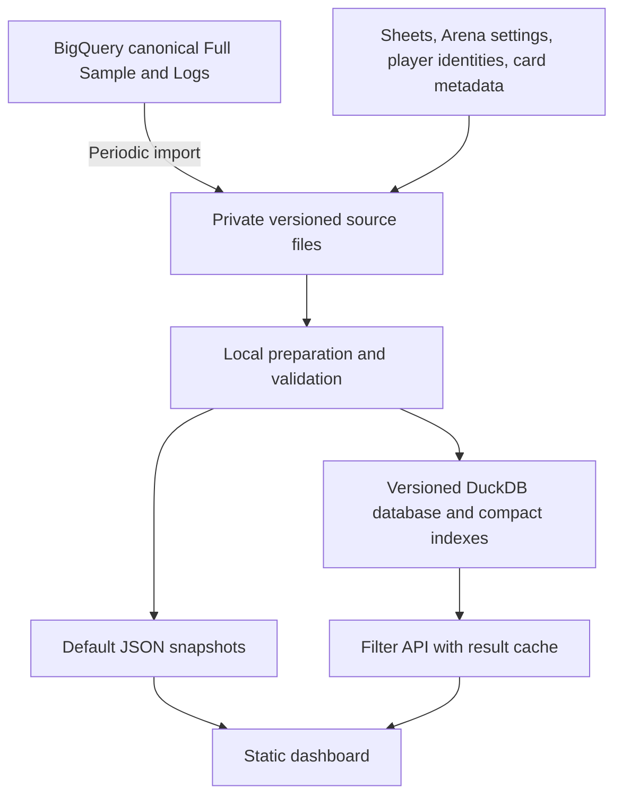

# Dashboard data architecture and operating cost

## Recommendation

Keep the current Google Cloud account and static frontend. Move statistical preparation and interactive filtering to a server that holds a private local copy of the data. Import the canonical Full Sample and Logs periodically, publish the same small JSON snapshots, and give the public API no ability to start BigQuery queries.

Use **DuckDB with columnar data files as the first implementation candidate**. DuckDB is a relational SQL database designed for analytical calculations. MySQL is a viable alternative, but changing to MySQL does not by itself make the existing pair expansion and repeated full-history calculations efficient. The deciding benchmark should be the hardest real dashboard filters on an affordable server.

The strongest evidence is a free BigQuery dry run of the two source imports: **6.24 GiB per complete import, or 0.189 TiB for 31 daily imports at today's source size**. At the current US on-demand analysis rate, this is approximately **$1.18/month before the free query allowance**. This figure covers source-query processing only. The server, storage, transfers, and other jobs still need a budget.[^1]

A total below **$20/month is plausible, but is not yet demonstrated**. A free-tier e2-micro serving a carefully prepared database, with heavier preparation performed by a short-lived worker if necessary, is the first budget candidate. It must pass a memory and latency benchmark. A paid 2 GiB e2-small is a simpler fallback but leaves little allowance for storage, networking, tax, and other jobs. Buying the VM before testing the workload would be premature.

This remains a proposed serving architecture, but its first Phase B bootstrap
artifact now exists locally. The deployed backend, refresh schedules, CI
behavior, and data populations have not been changed by the bootstrap. The
tool's default plan mode reads metadata only; no source export, rebuild, or
provisioning job has been executed. The earlier production evidence was
collected on 2026-09-15 through source inspection, table metadata, dry runs,
and one controlled refresh attempt.

## 1. Current data size and measured scan volume

### Physical data is small; repeated analysis is large

BigQuery table metadata reports the following sizes. These are logical bytes, not compressed download sizes, database disk sizes, or memory requirements. Row counts belong to different observation units and must not be interpreted as directly comparable game counts.

| Object | Rows | Logical GiB | Role |
|---|---:|---:|---|
| `all_games_stat_raw` | 6,456,228 | 4.181 | Physical Full Sample input, including rows the canonical view deduplicates |
| `game_log_stat_v2` | 436,526 | 2.056 | Physical Logs input with nested events |
| `full_stats_prepared` | 5,421,502 | 3.921 | Dashboard-normalized Full Sample from the previous refresh |
| `card_plays_prepared` | 6,946,869 | 0.943 | Played-card observations |
| `card_moment_observations` | 46,451,140 | 6.004 | Played, in-hand, and seen card observations |
| `card_pairs_prepared` | 54,689,490 | 9.154 | Expanded card-pair observations |
| `card_pair_daily_aggregates` | 54,689,490 | 9.910 | Pair moments with filter dimensions |
| `card_pair_scope_daily_aggregates` | 54,689,490 | 9.400 | Pair moments without round arrays |

The two physical source tables total **6.236 GiB**. The three pair tables alone total **28.464 GiB**. Neither aggregate copy reduces the number of rows at this observed state; both are larger than the original pair table in logical bytes. Their different clustering may help particular queries, but the row-count evidence rules out treating them as strongly compressed summaries.

The raw and prepared Full Sample counts also have different observation dates and deduplication semantics. Their difference is not a count of new games.

Exact metadata and dry-run results are preserved in [cost-architecture-evidence.json](C:/Users/ascri/Desktop/ark-nova-stats-dashboard/analysis/cost-architecture-evidence.json).

### Historical usage and the limits of attribution

The earlier August job audit in this task reported:

| Disjoint query category | Billed TiB | Share of the 23.214 TiB job total |
|---|---:|---:|
| CI query family | 13.255 | 57.1% |
| `CREATE TABLE AS SELECT` jobs | 2.481 | 10.7% |
| Remaining queries | 7.478 | 32.2% |
| Total | 23.214 | 100.0% |

Manual-user jobs accounted for approximately 0.025 TiB within the job total. They are not another category to add to this table. The billing statement separately reported 24.289 TiB and EUR 127.77 of BigQuery Analysis before promotional credit. The accounting difference is not reconciled here.

The retained component-CI query family serves only standalone component and
ordinary EV intervals; additive Synergy CIs have been removed. The
query-template totals do not identify how much each trigger caused. Likewise,
the remaining 7.478 TiB includes snapshot generation, cache warming, live
filtering, and potentially development-triggered backend work. It cannot
honestly be labeled entirely as visitor activity.

The earlier estimate of 0.04–0.10 TiB/day for a consolidated additive-Synergy
CI calculation is historical only and was never a capacity or budget commitment.
That calculation is retired; current CI work is limited to standalone component
and ordinary EV intervals.

## 2. What the current application actually does

The architecture already contains useful pieces worth retaining:

- GitHub Pages serves static HTML, CSS, and JavaScript.
- Default data comes from Cloud Storage JSON snapshots and a versioned default pack.
- Browser caches and in-flight request sharing avoid some duplicate HTTP requests.
- The backend has per-instance memory caching, persistent filtered-response objects, and BigQuery query caching.
- Records filters are already local to the downloaded record population. Arena bundles are prepared in advance.

An ordinary frontend build or CSS change requires **zero BigQuery analysis**. Development becomes expensive when it triggers a data rebuild, a source reconciliation query, a cold filter query, or CI generation. This distinction needs to become explicit in the development workflow.

The expensive path is a new filter scope missing the caches. The browser calls the Cloud Function, which builds SQL and starts BigQuery. Card + Card can first return a page and then materialize a complete scope in the background. Missing CI rows trigger a separate query. A failed default snapshot download can also fall back to the API through `loadStats()`.

Daily preparation currently has 21 orchestration steps; several create multiple tables. It recreates Full Sample and Logs, expands observations, generates derivatives, prepares Arena and player indexes, and queries many MW/Base view combinations for snapshots. Subsequent jobs warm Card + Card scopes and finish CIs.

Relevant source locations are listed in section 12. This assessment follows executable query paths; documentation alone is not sufficient because some descriptions are stale.

## 3. Specific inefficiencies and correctness risks

### 3.1 Full-history rebuilds without a source-change gate

`_run_daily_refresh()` always calls `_refresh_prepared_tables()`. `_write_data_version()` creates a timestamp version after rebuilding. No source-content comparison guards this work. A refreshed version therefore invalidates caches even when the inputs for a view are unchanged.

The Logs table's metadata last-modified timestamp was **2026-08-11 00:12:40 UTC**, while its downstream card derivatives were rebuilt on September 14. This does not prove those derivatives were unchanged: they also depend on Full Sample ratings and classifications. It does prove that rebuilding should follow the combined input dependencies, rather than the calendar alone.

The `all_games_stat` object is a **view**. Its own modification timestamp records definition changes, not new underlying games. Any freshness gate must include `all_games_stat_raw`, the view definition, relevant routines, and spreadsheet/metadata versions.

### 3.2 Pair expansion and aggregates that do not aggregate

With 20 distinct cards, one player-game creates 190 unordered pairs. At 30 cards it creates 435. The current pair builder repeats player names, card names, maps, dates, Elo values, and other filter dimensions on these observations.

The aggregate groups preserve exact player Elo, exact opponent Elo, date, map, starting position, completion, Arena/Tournament flags, cards, and—in one version—round arrays. Those dimensions distinguish most observations. The observed aggregate row counts are identical to the input pair count.

Moving these three wide copies into MySQL unchanged preserves the expansion and duplicate storage. The alternative is a narrow observation model with integer identifiers, shared player-game attributes, and genuinely reusable result caches.

### 3.3 CI batches repeat component work

The CI builder joins requested row keys to table-level observations and calculates component moments and covariance. Snapshot batches generally hold 100 rows; Card + Action Card uses 500. Each invocation adds at most six uncached batches per view before checkpointing.

The persistent CI key hashes the complete batch's row-key list. A card or pair appearing in a different batch does not automatically reuse the first batch's cached result. Baseline cards shared across many pairs can be read and expanded repeatedly.

Ordinary EV intervals often already come from count/mean/sample-SD fields in
the main aggregation. Those can remain inexpensive. Standalone component
intervals beneath Combo card names remain supported through the component-only
path; additive Synergy intervals are intentionally not requested.

### 3.4 Cache and request controls are incomplete cost controls

Arbitrary Elo bounds, map subsets, dates, and other filters create many distinct cache keys. Caching helps repeats; it cannot bound the cost of first-time requests.

The frontend aborts obsolete HTTP requests, but the inspected backend has no corresponding `job.cancel()` call. Stopping the browser's wait should not be assumed to stop BigQuery work. Cross-instance requests may also miss the same persistent cache concurrently before the first result is stored.

The main query submission paths do not set `maximum_bytes_billed` or workload labels. There is no application-wide byte allowance in the inspected code. Snapshot queries explicitly disable the BigQuery result cache, and replacing source derivatives would invalidate relevant cached queries anyway.

### 3.5 Refresh dependency and publication order need repair

`_refresh_prepared_card_play_aggregates_table()` reads `card_moment_observations`, but `_refresh_prepared_tables()` schedules that aggregate **before** refreshing card moments. It can therefore read the previous generation; an empty deployment can encounter a missing dependency. A generation label cannot make this input current.

Prepared tables are also replaced sequentially, with some explicit drops, and the data-version marker is written before all default snapshots complete. Atomic publication of the default pack does not make the entire set of mutable prepared tables atomic for live requests.

The replacement must build an isolated generation, validate it, then switch a single publication pointer. Each request must remain pinned to one generation for its whole lifetime.

## 4. Assessment of the proposed MySQL approach

| Suggestion | Assessment |
|---|---|
| Keep a periodic local copy of the source | Strong recommendation. It removes BigQuery from user interactions and makes development repeatable. |
| Store data alongside the website | Interpret this as private server storage or a private development data directory. Do not commit raw game data to the public frontend repository or download the complete data into every browser. |
| Build charts from stored data | Yes. Calculate compact result payloads on the server; keep the current browser chart rendering. |
| Use BigQuery to prepare all existing tables, then copy them | Saves interactive scans but retains expensive BigQuery preparation and data expansion. Import the source once and perform most preparation locally instead. |
| Use a relational database | Reasonable, but MySQL is only one choice. DuckDB is also relational and fits repeated grouping, joins, and numerical calculations. |
| BigQuery is an analytics database, so using it here is wrong | The dashboard workload is itself analytical. The mismatch is paying for repeated scans and unbounded interactive queries under a $20 budget. BigQuery remains useful as the upstream source and optional one-pass importer. |
| A $7 VM solves the cost problem | It changes the charging model, but RAM, sustained CPU, disks, backups, IP addresses, and transfers still matter. |

The screenshot shows an e2-micro estimate of $6.11 compute plus $1 for 10 GB balanced disk. That is a Compute Engine VM, **not a managed Cloud SQL MySQL service**. A self-managed MySQL installation would need its own updates, backup/restore procedure, tuning, API, and TLS configuration.

An e2-micro exposes two virtual CPUs but provides only **0.25 sustained CPU in total** and 1 GiB RAM. Bursting does not turn it into two continuously available cores. A public IPv4 address normally adds about **$3.65 for 730 hours**. Thus the screenshot's paid configuration is about $10.76 before other services and transfers, absent applicable allowances.[^2][^3]

MySQL's InnoDB uses RAM to cache table and index pages, alongside other database buffers. On a 1 GiB VM the API, operating system, database cache, and sorting/joining operations compete for the same small memory pool. This is not a claim that MySQL cannot run there; it is why performance needs measurement.[^4]

## 5. Recommended data workflow



### Import the canonical source first

The lowest-risk first version should import the canonical `all_games_stat` view result and physical Logs. The canonical view deduplicates source rows, reconstructs ratings where necessary, adjusts post-match Elo, resolves opponents, and computes derived values. Reimplementing all of this solely to avoid approximately $1.18 of monthly gross analysis would add avoidable migration risk.

The two successful dry runs were:

```sql
SELECT * EXCEPT(last_x_games)
FROM `freestyle-190711.ark_nova.all_games_stat`;

SELECT *
FROM `freestyle-190711.ark_nova.game_log_stat_v2`;
```

They estimated **4,488,895,349** and **2,207,432,311** processed bytes respectively. The view's precomputed `last_x_games` is excluded from this estimate because the dashboard needs to apply its own eligibility and filters before Last X. The migration must confirm the explicit imported field contract; it should not rely on an uncontrolled `SELECT *` in production.

These estimates show that retaining the canonical source transformation in BigQuery can still fit the budget. They do not measure import duration, result transfer, or local preparation time.

### Export alternatives and the distinction that matters

A native extract job for a physical BigQuery table uses the free shared export pool within its 50 TiB/day quota. `EXPORT DATA AS SELECT ...` runs a query and incurs query processing. Storage Read API has a separate free allowance and pricing. These operations must not be conflated.[^5]

`all_games_stat` is a logical view, so it cannot be directly read with Storage Read API. A practical initial implementation can query it into a short-lived table, then extract that table. Logs can use a native extract job directly. Parquet preserves the nested structures required by Logs, unlike CSV. Confirm export permissions for the worker identity; metadata visibility does not prove that identity can extract the source.[^6][^7]

For this US source, prefer an import bucket and VM in **us-central1**. Current pricing specifically makes BigQuery US-to-us-central1 batch export transfer free. A bucket in a broad US multi-region and a regional VM should not be assumed to have identical transfer treatment.[^5]

A later optimization could extract `all_games_stat_raw` and reproduce the canonical view locally. That requires pinning and testing the Elo routine, deduplication, tie-breaking, null semantics, and normalization. It is optional; migration success should not depend on it.

### Begin with complete imports, then process changed games locally

Neither physical source currently has partitioning or clustering. There is no verified change feed or reliable row-update timestamp in the assessed contract. Filtering `game_ended_at` to yesterday would miss late imports, historical corrections, and deletions. It might also still scan the entire unpartitioned table.

At this small source size, a complete import when the physical source changes is a reasonable starting point. Hash canonical records by table and exact player, compare the imported generation to the prior one, and rebuild only affected local observations where useful. Any changed player row invalidates its whole table's opponent/completion/corruption/telemetry calculations.

Retain a full reconciliation path. A safe incremental mechanism needs explicit handling for deletions and older changes; a recent-date overlap alone does not supply that guarantee. Hashing and reconciliation happen locally, so they do not repeat BigQuery scans.

Metadata-only changes should invalidate only their dependent products. A leaderboard sheet edit should not rebuild card pairs. An Arena definition change may affect eligibility across many games. A player-merge change should rebuild identity-dependent Players outputs while leaving exact-player card statistics intact.

### Separate data generation from refresh attempts

Use a content/version manifest covering canonical source data, schema/transformation version, and relevant metadata. Keep a separate timestamp for the last successful refresh check. Checking unchanged inputs should not create a fresh statistical version or invalidate caches.

Build into a new private generation. Generate the snapshots from that generation, run consistency checks, then publish the manifest. Keep the prior generation available for rollback and in-flight requests. A failed refresh preserves current data and reports the error without advancing the successful publication timestamp.

## 6. Local database and query design

### Store observations once

Proposed serving structures:

| Structure | Contents and purpose |
|---|---|
| `game_player` | Stable observation ID, table ID, exact player ID/name, dataset, timestamp, both Elo values, EV, maps, completion, corruption, Arena/Tournament, starting position, and required metrics |
| `player_identity` | Exact account to merged analytical identity; preserves separate exact-account use cases |
| `card_event` | Observation ID, integer card ID, event role, round, and source multiplicity where required |
| `card_membership` | Observation ID, card ID, role and round set for views requiring distinct membership |
| `endgame_event` / reward events | Narrow view-specific observations with original opportunity and missing-value semantics |
| `mw_selection` / `mw_draft` | Selected and drafted action-card observations with strict telemetry eligibility |
| Optional narrow pair index | Observation ID and integer card/round identifiers only; build only if it beats filtered membership joins |
| Result cache | Complete compact answers keyed by generation and normalized filter scope |

Map names, player names, card names, and shared per-game attributes should not be repeated in every pair. Integer IDs are a storage choice, not permission to merge statistically distinct observations.

First select eligible player-game observation IDs using the sidebar filters. Then join those IDs to the relevant narrow events. Calculate only required columns. Maintain local data ordering or indexes that support date/dataset scans and player histories. DuckDB can read selected columns and push filters into Parquet scans; exact speed depends on data layout and query plans.[^8]

For default Card + Card, prepare and cache the complete answer once per generation. For a new filter scope, compare two implementations: generating pairs after filtering membership, and scanning a narrow prebuilt pair index joined to eligible observations. Do not assume either wins before measuring.

Avoid precomputing every combination of Elo, dates, maps, and other filters; their number is too large. Do not round Elo values into coarse buckets to make aggregates smaller unless that statistical change is separately approved.

### Why DuckDB is the first candidate

The backend primarily performs read-only grouping, counts, means, joins, window functions, and statistical calculations. DuckDB can operate on local compressed columnar data without running a separate database server. Its SQL and nested-data capabilities reduce some translation work compared with moving the entire query catalog to MySQL.

Use a conservative process model: API readers open an immutable generation read-only; a separate builder writes the next generation. Readers switch after publication. This fits DuckDB's established file concurrency model and avoids concurrent processes writing the same database.[^9]

DuckDB can spill many operations to disk, but this does not guarantee a complex query will run in 1 GiB. Multiple joins, large groups, list/string aggregations, and parallel requests can still exhaust memory. Limit execution concurrency and thread count, reserve RAM for the API and OS, and provide actual local scratch disk.[^10]

SQL migration requires explicit tests for `SAFE_CAST`, `SAFE_DIVIDE`, null/NaN behavior, nested arrays, `QUALIFY`, case/collation, timestamp interpretation, distinct counts, statistical functions, and ties. Preserve output field names and the current request contract so most frontend code can remain in place.

### Why not put the database in the current Function's temporary directory?

Cloud Run's writable container filesystem consumes instance memory and is ephemeral. Downloading the whole database on every cold start, or relying on that filesystem for disk spilling, is unsuitable for a small-memory implementation. A persistent VM disk is simpler for the first benchmark. A serverless alternative would require an explicitly designed storage and cold-start strategy.[^11]

### Request execution and caching

The API should have one bounded analytical work queue, a short cache lookup path, normalized filter keys, and one in-flight computation per scope. Start with one heavy query at a time on micro hardware. Use a size-based cache limit rather than merely a number of entries.

Separate the expensive population scope from sorting, minimum count, Type, searches, and pagination where those operations can safely reuse a full result. Debounce Apply requests and stop queued stale requests. Give active requests a real query timeout. On resource exhaustion return a controlled retry response; never fall back silently to BigQuery.

The public serving identity should have no BigQuery job-submission permission. The importer owns the narrow source-read permissions. This turns zero BigQuery queries from live filters into an enforceable property.

## 7. Page and statistical behavior to preserve

| Family | Serving path after migration | Particular contract |
|---|---|---|
| Home | Default JSON; local aggregate for custom filters | Includes corrupted games; retains broader defaults |
| Cards / Opening Hand | Narrow card-event queries and snapshots | Separate role populations, play counts, repeated-round behavior, aliases, and CIs |
| Combos | Cached default answers; local filtered membership/pair/event queries | Component populations and pair projection remain view-specific |
| MW Action Cards | Selected/drafted observations and snapshots | Strict telemetry validation; By map same-map restriction |
| Maps / Actions / Predictors / Icons | Local player-game/event aggregates | Hard completion and specific metric denominators |
| Endgames / Sponsor Endgames | Local event/reward aggregates | Preserve missing rewards, opportunities, and score semantics |
| Build / Conservation / Scoring / Workers | Local metric and event aggregates | View-specific eligibility and optional versus hard completion |
| Players | Identity-indexed local histories and aggregates | Filters before Last X; merged identity; graph Elo's combined-dataset/all-status exception |
| Arena | Prepared bundles and local histories | Spreadsheet ID join, exact-account semantics, season definitions, completed subsets |
| Records | Existing merged static snapshots and browser filters | Spreadsheet overrides, enrichment, corruption exclusion, combined datasets |
| Elo peak updater | Local canonical-source peak lookup after import | Preserve sheet authority, historical maxima, ID joins, ties, and notification idempotency |
| Refresh | Lightweight control/status endpoint for the worker | Single active run, progress, atomic publication, password handling |

The current Cards query reads `card_moment_observations`, ultimately built from prepared Logs. The executable parity file still labels its source as `card_plays_prepared` and describes “Full Sample card plays.” The new contract matrix must reflect actual lineage. This assessment does not silently change that population.

Retain table-level clusters where inference needs them, even if point estimates use smaller moments. Never substitute an average of per-group averages. Carry counts and sums with their own null denominators. Distinct table counts are not interchangeable with player-game counts or sums of daily map counts.

### Confidence intervals are a separate product decision

The cost architecture does not require permanently removing all CIs.

Ordinary mean intervals can use valid counts, sums, and squared sums from the same aggregation as EV. For clustered single-card means, retain table-level sums and counts; both player observations from a game must remain grouped.

Additive Synergy is a point estimate only. Do not reintroduce its covariance
calculation into the serving path. Retain table-clustered standalone component
intervals and cache individual row/component results independently of the batch
requesting them.

The initial performance benchmark should include retained ordinary/component CIs,
but not additive Synergy CIs. Do not let optional CI work force another full
source import or block fresh point-estimate publication.

The separate daily Elo peak updater should be included in the migration accounting. It can use the already imported canonical source, preserving its independent Sheets and notification behavior. Merely moving the dashboard API would otherwise leave its BigQuery use in place.

## 8. Costs and the $20 limit

### BigQuery processing after migration

| Operation | BigQuery analysis after full migration |
|---|---|
| Edit/build/publish frontend | 0 |
| Open default tables and charts | 0 |
| Apply new filters | 0 |
| Sort, search, paginate | 0 |
| Calculate ordinary/component CIs on local data | 0 |
| Build snapshots from local data | 0 |
| Import both canonical sources daily | Estimated 0.189 TiB/month at current sizes |

That monthly import estimate is about **99.2% lower** than the earlier 23.214 TiB job total. It is a comparison between a proposed import-only query workload and historical total query use, not a claim that the whole cloud bill will fall by exactly that percentage.

If the raw Full Sample changes daily and Logs changes only once in a month, the analogous source scan estimate is **0.129 TiB/month**. Native extraction of Logs lowers query analysis further. Growth, retries, development queries, and any remaining legacy jobs add to these figures. Local disk reads are still real work, but are not BigQuery-billed scans.

### Hardware prices and allowances

Current Iowa on-demand list prices, calculated for 730 hours:[^12]

| VM | RAM | Sustained CPU allocation | Compute/month, before allowances |
|---|---:|---:|---:|
| e2-micro | 1 GiB | 0.25 | $6.11 |
| e2-small | 2 GiB | 0.5 | $12.23 |
| e2-medium | 4 GiB | 1 | $24.46 |
| e2-standard-2 | 8 GiB | 2 | About $2.08 for **31 hours**, not a full month |

Eligible free-tier usage covers one e2-micro's monthly hours in specified US regions and 30 GB-months of standard persistent disk. It does not grant a free e2-small, and balanced disk is a different SKU. Allowances are shared and require an active billing account.[^13]

Standard disk list pricing in Iowa is $0.04/GB-month; balanced disk is $0.10/GB-month. More disk space may be needed for the active generation, staging generation, temporary spill files, and rollback. Disk performance also needs to be measured; the cheapest small disk may limit broad scans.[^14]

### Candidate budget

The following is an allocation for a **low-traffic** deployment using an eligible free e2-micro. It is conditional on the service passing the hardware benchmark and retiring unnecessary legacy resources.

| Item | Planning allowance/month |
|---|---:|
| Eligible e2-micro compute | $0 |
| One public IPv4 address | $3.65 |
| Disk capacity above applicable free allowance, including worker disk | $0–3 |
| Private imports, compact backups, public snapshots | $0.50–2 |
| Optional short-lived preparation worker | $0–3 |
| Small network/logging/scheduling/secret overhead | $1–3 |
| Source analysis | $0–1.18 at measured import volume |
| Indicative subtotal before tax and growth | **About $5–16** |

This leaves a route to a $20 total, not a guarantee. The practical target should be nearer $12–15 before tax, with explicit headroom. Regional Storage can be inexpensive—for example, 50 GiB at $0.02/GiB-month is $1 before allowances—but operations, egress, retained generations, and soft-deleted objects also count.[^15]

A paid e2-small has a tighter example: $12.23 compute + $3.65 IPv4 + $1.20 for 30 GB standard disk is already **$17.08**, before backups, transfers, other jobs, or tax and before any eligible disk credit. A 4 GiB e2-medium exceeds the $20 target on compute alone. These are reasons to benchmark carefully and avoid assuming “a small VM costs $7 all-in.”

A managed Cloud SQL micro is a separate option with only 0.6 GiB RAM; the next shared-core size lists about $25.55/month of compute. The smallest managed database is not automatically fast enough, and its price does not include the API and all storage. It is not the first candidate for this workload/budget.[^16]

### Traffic determines whether the cheap server is enough

For capacity planning, let `Q` be uncached requests per day and `t` be CPU seconds per request. The mean CPU demand is `Q × t / 86,400` sustained cores. With an e2-micro's nominal 0.25 sustained core, 1,000 requests taking two CPU seconds each consume roughly 9% of daily CPU capacity; 10,000 consume roughly 93%, before imports and other work. These are illustrative inputs, not measured dashboard performance. Bursts and concurrent requests still create queues.

Measure compressed response sizes and public snapshot transfer. Avoid sending an all-dashboard pack to every new visitor if they use only one page; preserve a manifest and lazy page-group loading if pack traffic becomes material. Do not replace BigQuery scan charges with multi-gigabyte browser downloads.

If the cheapest GCP configuration fails, the choices are a larger budget, a slower/asynchronous broad-query experience, a narrower optional heavy feature, or a separately evaluated fixed-price host while retaining the current GCP source account. The current evidence does not justify promising all filters under five seconds at arbitrary traffic for $20.

## 9. Alternatives compared

| Option | Strength | Main limitation | Decision |
|---|---|---|---|
| Existing BigQuery API with more caches | Least migration effort | First-time public scopes remain a variable scan bill | Temporary containment only |
| MySQL on a small VM | Mature indexes, transactions, fixed compute | Large group-bys and pair joins still consume CPU/I/O; raw migration requires schema/query work | Viable benchmark comparator |
| PostgreSQL on a small VM | Flexible SQL and indexes | Similar memory and analytical scan constraints | Viable comparator, no need to introduce alongside DuckDB initially |
| DuckDB on persistent local disk | Analytical SQL, compact columnar storage, simple read-only generation model | Low-memory and concurrent heavy queries need limits | **First candidate** |
| Cloud SQL | Managed database operations | Tight budget and tiny affordable configurations | Not first choice |
| Entire raw dataset in browser | No filter backend | Download size, mobile RAM, duplicated work, uncontrolled raw publication | Reject for the full dashboard |
| Local desktop builds only | Cheap development and no cloud compute during development | Computer uptime and publication dependence | Useful development workflow; not automatic public hosting |
| Existing Function plus database downloaded on cold start | Reuses serverless endpoint | Ephemeral memory-backed filesystem and repeated cold downloads | Avoid as the initial design |

## 10. Migration sequence and acceptance gates

### Phase A — contain the old workload before paid operation resumes

Inventory and explicitly pause the expensive CI and warm-up schedules; gate manual refreshes and any public backend fallback that can start uncapped queries. Preserve the separate Elo updater unless its replacement is ready, but include it in the byte allowance. Keep source tables read-only.

Apply byte ceilings to every remaining BigQuery query, including maintenance and diagnostics, and daily project query quotas with headroom below the budget. Label jobs by workload, view, data generation, and run ID so scheduled, manual, filtered, and CI work can be distinguished. A per-query ceiling alone does not limit a large number of small queries.[^17]

Standard budget alerts are notifications. Current preview spend caps cover selected services including Cloud Run/functions; they are not a universal BigQuery/VM/storage ceiling, have enforcement delay, and do not stop all persistent-resource charges. The primary controls here should be permissions, byte quotas, bounded workers, and rate limits.[^18][^19]

The production backend and local working copy implement the application-side containment:
uncached public BigQuery work is disabled by default, optional CI/warm-up stages
are disabled, every SQL job receives labels and a byte ceiling, unchanged input
generations skip analytical rebuilds, Elo-sheet-only publication is isolated,
and the card-moment dependency order is corrected. As of 2026-09-15, the two
optional high-cost Scheduler jobs are paused, the project-level daily BigQuery
query quota is `0.1 TiB`, and the protected function is deployed. A controlled
legacy refresh processed 68.2703 GiB before snapshot publication exposed an
incorrect 2 GiB workload classification; that query was rejected before billing,
the previous atomic pack was preserved, and snapshot queries now use the 64 GiB
maintenance ceiling. The main refresh schedule remains paused because repeating
the non-publishing legacy cycle would waste the remaining daily quota. See
[phase-1-cost-containment-runbook.md](phase-1-cost-containment-runbook.md).

### Phase B — build a private representative local data environment

The first bootstrap tool is
[`phase2-local-import.py`](phase2-local-import.py). Its metadata-only `plan`
command records the canonical Full Sample and Logs schemas plus a stable
source fingerprint without an analysis query. Its explicit `export` command
performs one canonical Full Sample Parquet export and one native Logs Parquet
extract into a caller-selected private, versioned bucket, recording the import
job and bytes in a manifest. Its `download` command copies a completed
generation to a private builder directory. A partial generation is never a
serving pointer. No export has been run yet.

Import one coherent source generation, recording query bytes and exported file
sizes. Preserve the schema and metadata versions. Keep the data outside public
Git and the static web root.

Port the canonical preparation and a vertical slice: Cards, Players history, MW Synergies, and the difficult Card + Card query. Start the existing frontend against a local API. Thereafter, frontend development, SQL changes, CI experiments, and most tests run on the saved generation with no repeated BigQuery queries.

### Phase C — benchmark before provisioning the permanent server

Compare real requests on 1 GiB and 2 GiB limits, plus a larger local reference. A RAM limit on a fast desktop does not simulate an e2-micro's CPU or disk; final acceptance needs the actual candidate hardware or equivalent throttling.

Measure cold and cached latency, CPU seconds, peak resident memory, scratch-disk use, compressed payload size, and one complete preparation run. Include concurrent requests and a refresh while the old generation serves.

The focused benchmark set should cover:

1. Cards default and all-map/all-date low-Elo scopes.
2. Players General, five-player Comparison, Last X, per-map performance, and Elo history.
3. Card + Card without selected cards, with selected cards, low minimum plays, and round restrictions.
4. Card + Action Card and MW Synergies with/without CIs.
5. A wide Maps query and representative nested reward/Endgames queries.
6. Repeated cache hits, simultaneous identical requests, and queue cancellation.

Targets: snapshot interactions remain immediate; cache hits should approach the existing subsecond experience; ordinary uncached filters should aim for the existing five-second target. Explicitly measure and decide what is acceptable for the heaviest broad scope. No memory exhaustion or partial generation may be accepted.

### Phase D — move the remaining query families

Keep the API request/response contract and snapshot paths where practical. Port numerical logic and type handling; parameterize values. Compare each family against frozen reference payloads and a small number of bounded canonical BigQuery reconciliations. Use the existing population audit as a starting point, correcting its stale source descriptions.

Move CI calculation, player indexes, Arena generation, Records enrichment, and peak lookup onto the imported data. Preserve the updater's Sheet/notification idempotency and manual record overrides. Remove the old BigQuery fallback from migrated routes.

### Phase E — publish and retire duplication

Run a complete candidate build and verify counts, means, intervals, row identifiers, hashes, and version consistency. Test a failed import and a failed build: both must leave the previous successful generation served. Switch the API and manifest only after this check.

After the rollback window and parity acceptance, retire the obsolete dashboard-owned BigQuery derivatives, CI stages, warm-up jobs, old object generations, and unused deployment images. Do not delete upstream tables or unrelated source-owner infrastructure. Verify the remaining monthly storage bill as part of this cleanup.

## 11. What remains unmeasured

The architecture and source-import cost now have concrete evidence. The following still require the prototype or a later billing-enabled check:

- Compressed source exports and compact DuckDB/index sizes.
- Actual cold filter and CI performance on micro hardware.
- Refresh wall time, CPU time, spill volume, and safe worker runtime allowance.
- Visitor traffic, cache-miss rate, and network egress by page group.
- Exact scheduled-versus-interactive attribution within historical SELECT jobs.
- Effective source-read/export permissions for the intended runtime identity.
- A full inventory of retained cloud storage, soft delete, images, and account-level free allowances.
- Confirmed account currency/tax treatment for an all-in $20 cap.

These gaps affect the VM choice and total bill. They do not undermine the central result: importing the canonical sources periodically can reduce BigQuery query volume from tens of TiB to roughly two tenths of one TiB per month at the current source size, while moving all visitor filtering to fixed compute.

## 12. Implementation evidence and sources

### Local code evidence

| Concern | Reference |
|---|---|
| Prepared source tables and exact Elo semantics | [main.py:2722](C:/Users/ascri/Desktop/ark-nova-function/main.py:2722) and [main.py:2821](C:/Users/ascri/Desktop/ark-nova-function/main.py:2821) |
| Pair expansion and aggregate dimensions | [main.py:3598](C:/Users/ascri/Desktop/ark-nova-function/main.py:3598) and [main.py:3711](C:/Users/ascri/Desktop/ark-nova-function/main.py:3711) |
| Card-role events and multiplicity | [main.py:4171](C:/Users/ascri/Desktop/ark-nova-function/main.py:4171) |
| Refresh dependency order | [main.py:4837](C:/Users/ascri/Desktop/ark-nova-function/main.py:4837) |
| Actual Cards query source | [main.py:5220](C:/Users/ascri/Desktop/ark-nova-function/main.py:5220) |
| CI query, cache, and batch behavior | [main.py:9542](C:/Users/ascri/Desktop/ark-nova-function/main.py:9542), [main.py:9913](C:/Users/ascri/Desktop/ark-nova-function/main.py:9913), [main.py:13106](C:/Users/ascri/Desktop/ark-nova-function/main.py:13106) |
| Timestamp-based data version | [main.py:2288](C:/Users/ascri/Desktop/ark-nova-function/main.py:2288) |
| Main daily refresh | [main.py:13698](C:/Users/ascri/Desktop/ark-nova-function/main.py:13698) |
| Browser API fallback and abort behavior | [snapshot-cache.js:228](C:/Users/ascri/Desktop/ark-nova-stats-dashboard/assets/js/snapshot-cache.js:228) |
| Population inventory | [audit_population_parity.py](C:/Users/ascri/Desktop/ark-nova-function/audit_population_parity.py) |
| Independent Elo system | [elo_system_handoff.md](C:/Users/ascri/Desktop/ark-nova-stats-dashboard/elo_system_handoff.md) |
| Measured table sizes and dry runs | [cost-architecture-evidence.json](C:/Users/ascri/Desktop/ark-nova-stats-dashboard/analysis/cost-architecture-evidence.json) |
| Supplied VM estimate | `C:/Users/ascri/Downloads/mysql.png`, screenshot supplied with the request |

### Primary references

All web references were accessed on 2026-09-15. Prices are USD list prices in the specified region; they are not an account-specific quote.

[^1]: Google Cloud, [BigQuery pricing overview](https://cloud.google.com/bigquery), current on-demand analysis rate and free monthly query allowance. Source-volume calculations use the recorded dry runs, not the product page.
[^2]: Google Cloud, [General-purpose machine family](https://docs.cloud.google.com/compute/docs/general-purpose-machines), E2 shared-core sustained CPU and memory specifications.
[^3]: Google Cloud, [Network pricing](https://cloud.google.com/vpc/network-pricing), external IPv4 rate and separate network charges.
[^4]: Oracle, [MySQL 8.4 InnoDB parameters](https://dev.mysql.com/doc/refman/8.4/en/innodb-parameters.html), buffer pool and memory behavior.
[^5]: Google Cloud, [BigQuery pricing](https://cloud.google.com/bigquery/pricing), native extraction, SQL export, Storage Read API, and US-to-Iowa export transfer treatment.
[^6]: Google Cloud, [Use the BigQuery Storage Read API](https://docs.cloud.google.com/bigquery/docs/reference/storage), view limitations and read-session permissions.
[^7]: Google Cloud, [Export table data to Cloud Storage](https://docs.cloud.google.com/bigquery/docs/exporting-data), export formats and nested/repeated data support.
[^8]: DuckDB, [Reading and writing Parquet files](https://duckdb.org/docs/lts/data/parquet/overview), column selection and filter pushdown.
[^9]: DuckDB, [Concurrency](https://duckdb.org/docs/stable/connect/concurrency.html), stable read-only file access and single-writer process model.
[^10]: DuckDB, [Tuning workloads](https://duckdb.org/docs/current/guides/performance/how_to_tune_workloads), out-of-core processing and memory limitations.
[^11]: Google Cloud, [Cloud Run container runtime contract](https://docs.cloud.google.com/run/docs/container-contract), writable filesystem memory use and lifecycle.
[^12]: Google Cloud, [General Purpose VM pricing](https://cloud.google.com/products/compute/pricing/general-purpose), Iowa on-demand E2 rates; monthly and worker figures are arithmetic at these hourly rates.
[^13]: Google Cloud, [Free Cloud features](https://docs.cloud.google.com/free/docs/free-cloud-features), Compute Engine eligibility, regions, disk allowance, and account requirements.
[^14]: Google Cloud, [Block storage pricing overview](https://cloud.google.com/products/block-storage), Iowa standard and balanced disk rates.
[^15]: Google Cloud, [Cloud Storage pricing](https://cloud.google.com/storage/pricing), storage, operations, retained versions, and network charging.
[^16]: Google Cloud, [Cloud SQL pricing](https://cloud.google.com/sql/pricing), shared-core database size and compute pricing.
[^17]: Google Cloud, [Estimate and control BigQuery costs](https://docs.cloud.google.com/bigquery/docs/best-practices-costs), dry runs, byte limits, and query cost controls.
[^18]: Google Cloud, [Budgets and alerts](https://docs.cloud.google.com/billing/docs/how-to/budgets), standard alerts-only budgets do not cap spending.
[^19]: Google Cloud, [Manage spend cap budgets](https://docs.cloud.google.com/billing/docs/how-to/budgets-spend-caps), preview scope, eligible services, persistent-resource exceptions, and enforcement limitations.
